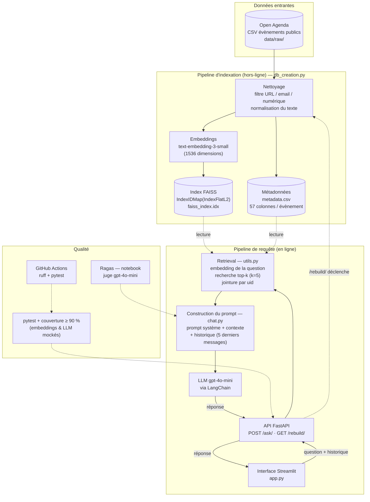

# Assistant intelligent de recommandation d'événements culturels — Rapport technique

> POC RAG (Retrieval-Augmented Generation) réalisé pour **Puls-Events** : un assistant conversationnel qui répond aux questions sur les événements publics de **Toulouse** à partir des données Open Agenda.

## Sommaire

1. [Objectifs du projet](#1-objectifs-du-projet)
2. [Architecture du système](#2-architecture-du-système)
3. [Préparation et vectorisation des données](#3-préparation-et-vectorisation-des-données)
4. [Choix du modèle NLP](#4-choix-du-modèle-nlp)
5. [Construction de la base vectorielle](#5-construction-de-la-base-vectorielle)
6. [API et endpoints exposés](#6-api-et-endpoints-exposés)
7. [Évaluation du système](#7-évaluation-du-système)
8. [Recommandations et perspectives](#8-recommandations-et-perspectives)
9. [Organisation du dépôt](#9-organisation-du-dépôt)
10. [Annexes](#10-annexes)

---

## 1. Objectifs du projet

- **Contexte** : Puls-Events développe une plateforme de recommandations culturelles personnalisées. La mission consiste à prototyper un assistant capable de répondre en langage naturel aux questions des utilisateurs sur les événements publics de la ville.
- **Problématique** : les moteurs de recherche à mots-clés gèrent mal les formulations libres (« un concert de piano aux Jacobins ? », « un atelier pour créer mon entreprise »). Un LLM seul, lui, **hallucine** et ne connaît pas l'agenda local à jour. Un système RAG combine les deux : la **recherche sémantique** retrouve les événements pertinents dans une base à jour, et le **LLM** reformule une réponse naturelle, **strictement ancrée** dans ces événements.
- **Objectif du POC** : démontrer
  - la **faisabilité technique** (pipeline complet données → index → LLM → API),
  - la **valeur métier** (réponses utiles, sourcées, qui admettent ne pas savoir),
  - la **qualité mesurable** (évaluation quantitative avec Ragas).
- **Périmètre** :
  - **Zone** : Toulouse (`location_city = Toulouse` pour 100 % des documents indexés) ;
  - **Période** : événements publics de l'agenda, de août 2025 à aujourd'hui ;
  - **Données** : export CSV Open Agenda `evenements-publics-openagenda.csv` (57 colonnes), **4 903 événements indexés** après nettoyage.

---

## 2. Architecture du système

### 2.1 Schéma global



### 2.2 Flux de données

1. **Indexation** : le CSV brut est lu, les descriptions inutilisables sont écartées, le texte est normalisé puis vectorisé. Les vecteurs sont stockés dans FAISS, indexés par l'`uid` Open Agenda ; les lignes complètes sont conservées dans `metadata.csv`.
2. **Requête** : la question est vectorisée avec le même modèle, FAISS renvoie les 5 `uid` les plus proches, les lignes correspondantes de `metadata.csv` sont reconstituées sous forme clé-valeur et injectées dans le prompt système.
3. **Génération** : le LLM répond en s'appuyant exclusivement sur ce contexte et sur les 5 derniers messages de la conversation.

### 2.3 Technologies utilisées

| Couche | Technologie | Rôle |
|---|---|---|
| Langage / environnement | Python ≥ 3.13, **uv** | Gestion des dépendances et de l'environnement (`uv.lock`) |
| Données | **pandas** | Lecture CSV, nettoyage, jointures |
| Prétraitement | `re`, **langchain-text-splitters** | Normalisation, découpage (`RecursiveCharacterTextSplitter`) |
| Embeddings | **OpenAI** `text-embedding-3-small` | Vectorisation sémantique (1536 dim.) |
| Base vectorielle | **FAISS** (`faiss-cpu`) | Recherche de plus proches voisins |
| Orchestration LLM | **LangChain** (`init_chat_model`, messages typés) | Abstraction du fournisseur et des messages |
| LLM | **gpt-4o-mini** | Génération des réponses |
| API | **FastAPI** + **Pydantic** + **uvicorn** | Exposition REST, validation des entrées |
| Interface | **Streamlit** | Chat de démonstration |
| Évaluation | **Ragas** (+ `datasets`) | Métriques RAG (juge `gpt-4o-mini`) |
| Qualité | **pytest**, **pytest-cov**, **ruff**, **GitHub Actions** | Tests, couverture, lint, CI |

---

## 3. Préparation et vectorisation des données

### 3.1 Source de données

- **Origine** : export CSV de l'agenda *Évènements publics* d'Open Agenda, séparateur `;`, chemin attendu `data/raw/evenements-publics-openagenda.csv` (dossier ignoré par git).
- **Filtre géographique et temporel** : Toulouse année 2025-2026 (l'export est déjà restreint).
- **Colonnes principales** : `uid`, `title_fr`, `description_fr`, `longdescription_fr`, `daterange_fr`, `firstdate_begin`, `lastdate_end`, `location_name`, `location_address`, `category`, `keywords_fr`, `conditions_fr`, `registration`, etc.

### 3.2 Nettoyage

Implémenté dans `src/app/db_creation.py`, appliqué à la colonne **`description_fr`** :

| Étape | Fonction | Effet |
|---|---|---|
| Suppression des valeurs manquantes | `dropna()` | Écarte les événements sans description |
| Détection des descriptions « vides de sens » | `check_for_dry_emails_urls_or_numeric` | Rejette les descriptions réduites à une **URL**, un **email** ou un **nombre** |
| Normalisation | `normalize_text` | Minuscules, espaces multiples fusionnés, tirets entre lettres → espace, ponctuation et caractères spéciaux supprimés, suppression du « de » initial (ex. « de piano » → « piano ») |

Les lignes rejetées sont retirées de la base : les documents indexés et les métadonnées restent donc alignés par `uid`.

### 3.3 Chunking

- **Outil** : `RecursiveCharacterTextSplitter` (`chunk_size=1000`, `chunk_overlap=200`), fonction `split_text_into_chunks`.
- **Raison d'être** : éviter de dépasser la fenêtre d'entrée du modèle d'embedding et améliorer la granularité de la recherche sur les textes longs.
- **État actuel** : la fonction existe et est testée, mais **n'est pas appelée** dans `rebuild_faiss_index()`. Les descriptions indexées sont courtes (**moyenne ≈ 95 caractères, maximum 200**), donc un seuil de 1000 caractères ne découperait de toute façon rien. **Un chunking n'a de sens que si l'on indexe des textes plus longs** (`longdescription_fr`, voir §8).

### 3.4 Embedding

| Paramètre | Valeur |
|---|---|
| Modèle | `text-embedding-3-small` (OpenAI) |
| Dimensionnalité | **1536** |
| Format | `float32`, un vecteur par événement |
| Logique de batch | **Aucune** : un appel API par document (`get_embeddings`), simple mais lent et coûteux à reconstruire |
| Texte vectorisé | `description_fr` nettoyée uniquement |

---

## 4. Choix du modèle NLP

- **Modèle sélectionné** : **`gpt-4o-mini`** (OpenAI) pour la génération, instancié via `langchain.chat_models.init_chat_model`. Le même modèle (température 0) sert de juge à Ragas.
- **Pourquoi ce modèle ?**
  - **Coût** : très faible coût par token, adapté à un POC et aux évaluations répétées ;
  - **Qualité** : bon niveau en français, bonne obéissance aux consignes de prompt (refus explicites quand l'information manque) ;
  - **Compatibilité LangChain** : intégration native, fournisseur interchangeable via `init_chat_model` ;
  - **Cohérence** : un seul fournisseur pour embeddings, génération et évaluation.
- **Prompting** : prompt système unique (`src/app/chat.py`, `build_prompt_session`) structuré en quatre blocs :
  1. **Rôle** : assistant officiel de Puls-Event, périmètre « évènements publics à Toulouse » ;
  2. **Source autorisée** : uniquement la base de connaissances ;
  3. **Comportements obligatoires** : ton formel et courtois, demande de précisions si la question est ambiguë, aveu explicite en cas d'information manquante, alternative cohérente si possible ;
  4. **Comportements interdits** : ne jamais inventer d'événements, lieux ou dates.

  Les segments récupérés sont ajoutés sous la forme `--- Événement i ---` suivie des champs clé-valeur, puis d'une consigne de signaler l'insuffisance des informations. L'historique est tronqué aux **5 derniers messages** et les messages `system` entrants sont filtrés.
- **Limites du modèle** :
  - **dépendance à un service externe** (latence, coût, disponibilité, confidentialité des données envoyées) ;
  - pas de raisonnement temporel fiable : « ce week-end » ou « le mois prochain » ne sont pas résolus, la date du jour n'étant pas fournie au modèle ;
  - sensibilité à la formulation, avec un risque résiduel de réponse non strictement fidèle (*faithfulness* ≈ 0,85).

---

## 5. Construction de la base vectorielle

- **FAISS utilisé** : `faiss.IndexIDMap(faiss.IndexFlatL2(1536))`
  - `IndexFlatL2` : recherche **exacte** (force brute) en distance euclidienne. Les embeddings OpenAI étant normalisés, le classement L2 équivaut à celui de la similarité cosinus. Avec ~5 000 vecteurs, la latence est négligeable et aucune approximation n'est nécessaire.
  - `IndexIDMap` : permet d'utiliser l'**`uid` Open Agenda comme identifiant FAISS**, ce qui évite toute table de correspondance position ↔ document.
- **Stratégie de persistance** :
  - format natif FAISS : `data/processed/faiss_index.idx` (`faiss.write_index` / `read_index`) ;
  - métadonnées : `data/processed/metadata.csv` ;
  - nommage fixe, rechargé au démarrage de l'API ; la route `/rebuild/` régénère les deux fichiers puis recharge l'index en mémoire.
- **Métadonnées associées** : pour chaque document, **toute la ligne du CSV** nettoyée est conservée (57 colonnes : titre, descriptions, dates, lieu, adresse, coordonnées, catégorie, mots-clés, conditions, inscription, contacts, etc.). À la recherche, la ligne est retrouvée par `uid` puis formatée en texte `colonne: valeur` (valeurs vides ignorées) et transmise au LLM.
- **Volumétrie** : 4 903 vecteurs × 1536 dimensions.

---

## 6. API et endpoints exposés

- **Framework** : **FastAPI** (validation **Pydantic**, documentation Swagger sur `/docs`).
- **Lancement** (depuis `src/`) :

```bash
uv sync
cd src
uv run uvicorn app.api:app --reload
# Interface Streamlit (optionnelle)
uv run streamlit run app/app.py
```

La variable d'environnement `OPENAI_API_KEY` doit être définie (fichier `.env`).

### Endpoints

| Méthode | Route | Rôle |
|---|---|---|
| `POST` | `/ask/` | Pose une question (avec historique optionnel) et retourne la réponse de l'assistant |
| `GET` | `/rebuild/` | Reconstruit l'index FAISS depuis le CSV brut et le recharge en mémoire |

### Format des requêtes / réponses

**Requête `POST /ask/`**

```json
{
  "user_question": "Y a-t-il un concert de piano aux Jacobins ?",
  "messages": [
    {"role": "human", "content": "Bonjour"},
    {"role": "ai", "content": "Comment puis-je vous aider ?"}
  ]
}
```

- `user_question` : obligatoire, non vide (espaces retirés) ;
- `messages` : optionnel ; `role` ∈ `human | ai | system`.

**Réponse** : une chaîne de caractères JSON (texte de l'assistant).

**Réponse `GET /rebuild/`**

```json
{
  "nb of indexed documents": 4903,
  "dimension of the embeddings": 1536,
  "index path": ".../data/processed/faiss_index.idx",
  "metadata path": ".../data/processed/metadata.csv"
}
```

### Exemples d'appel

```bash
curl -X POST http://127.0.0.1:8000/ask/ \
  -H "Content-Type: application/json" \
  -d '{"user_question": "Un atelier pour créer mon entreprise ?"}'
```

```python
import requests

r = requests.post(
    "http://127.0.0.1:8000/ask/",
    json={"user_question": "Un récital de piano aux Jacobins ?"},
    timeout=60,
)
print(r.json())
```

### Gestion des erreurs

| Cas | Code | Détail |
|---|---|---|
| Question vide ou absente, rôle invalide | `422` | Validation Pydantic |
| Index non chargé | `503` | Invite à appeler `/rebuild/` |
| CSV brut absent lors du `/rebuild/` | `503` | Message `FileNotFoundError` |
| Échec de l'appel LLM | `200` | Message d'excuse générique, exception journalisée |

### Tests effectués

- **Tests unitaires** (`tests/unit/`) : nettoyage et normalisation, chunking, reconstruction d'index (cas nominal et CSV manquant), construction du prompt (contexte, troncature de l'historique), `run_rag_query`, erreur LLM, initialisation paresseuse du modèle, recherche FAISS (UID inconnus, index manquant).
- **Tests fonctionnels** (`tests/api_test.py`) : `/ask/` et `/rebuild/` via `TestClient` (succès, 422, 503, rôles de l'historique, placeholder Swagger).
- **Reproductibilité sans clé API** : embeddings déterministes basés sur un hash SHA-256 et LLM mocké (`tests/conftest.py`) ; mini-jeu de données `tests/fixtures/sample_events.csv`.
- **CI** (GitHub Actions) : `ruff check` puis `pytest` avec **couverture ≥ 90 %** sur les PR vers `main` / `dev`.

### Limitations connues de l'API

- Réponse **non streamée** et **sans sources** renvoyées au client ;
- état global (index, données) partagé dans le processus, pas de mécanisme d'authentification ni de limitation de débit ;
- `/rebuild/` est accessible sans protection et peut être coûteux (un appel d'embedding par document) ;
- l'historique n'est pas conservé côté serveur : le client doit le renvoyer à chaque appel.

---

## 7. Évaluation du système

Le détail complet se trouve dans [`tests/rag_test/RAPPORT_RAGAS.md`](tests/rag_test/RAPPORT_RAGAS.md).

### 7.1 Protocole

- **Outil** : [Ragas](https://docs.ragas.io) via le notebook [`tests/rag_test/ragas_evaluation.ipynb`](tests/rag_test/ragas_evaluation.ipynb).
- **Échantillon** : **7 questions** annotées manuellement (réponse de référence rédigée à la main à partir de `metadata.csv`). Les réponses et les contextes FAISS générés sont figés dans [`rag_predictions.json`](tests/rag_test/rag_predictions.json) pour pouvoir rejouer l'évaluation sans régénérer.
- **Juge** : `gpt-4o-mini` (température 0), embeddings `text-embedding-3-small`.
- **Métriques** :

| Métrique | Ce qu'elle mesure |
|---|---|
| `faithfulness` | La réponse reste fidèle aux contextes récupérés (pas d'invention) |
| `answer_relevancy` | La réponse traite bien la question posée |
| `context_precision` | Les segments récupérés sont utiles pour la réponse de référence |
| `context_recall` | Les faits attendus sont présents dans les segments récupérés |

- **Seuil « acceptable »** (critère maison) : `faithfulness ≥ 0,7` **et** `answer_relevancy ≥ 0,7`.
- **`pytest` vs Ragas** : `pytest` valide le pipeline technique (mocks, sans API) ; Ragas mesure la qualité métier (avec coût et latence d'API).

### 7.2 Résultats (run du 12/10/2026)

| Métrique | Moyenne | Lecture |
|---|---|---|
| **faithfulness** | **0,85** | Les réponses s'appuient sur les contextes ; peu d'inventions |
| **answer_relevancy** | **0,56** | Hétérogène ; deux refus « hors sujet » tirent la moyenne vers le bas |
| **context_precision** | **0,76** | Segments souvent utiles, mais bruités sur certaines requêtes |
| **context_recall** | **0,43** | Une bonne part des faits attendus est absente du top-5 |

**Taux acceptable : 3 / 7 (42,9 %)**.

| # | Question | Faith. | Ans. rel. | Ctx prec. | Ctx recall | Verdict |
|---|---|---|---|---|---|---|
| Q01 | Atelier métiers du numérique | 0,92 | 0,70 | 1,00 | 0,50 | Bon match, recall partiel |
| Q02 | Rendez-vous agence YES (Borderouge) | 0,67 | 0,00 | 1,00 | 0,00 | **Échec du retrieval** : refus honnête |
| Q03 | Job Dating Minimes / Liebherr | 0,67 | 0,00 | 0,00 | 0,00 | **Échec du retrieval** : cible absente du top-5 |
| Q04 | Atelier création d'entreprise | 0,88 | 0,65 | 1,00 | 0,00 | Bon événement mais différent de la référence |
| Q05 | Concert Fazil Say (Jacobins) | 0,80 | 0,94 | 0,33 | 0,50 | Réponse pertinente, contexte bruité |
| Q06 | KIWI Indus/Logistique (Borderouge) | 1,00 | 0,78 | 1,00 | 1,00 | **Référence** |
| Q07 | Récital Elisabeth Brauss (Jacobins) | 1,00 | 0,83 | 1,00 | 1,00 | **Succès complet** |

### 7.3 Analyse

**Ce qui fonctionne**
- **Génération prudente** : le prompt « n'inventez pas » est respecté (faithfulness 0,85) ; quand l'événement est absent du contexte, le modèle le dit au lieu d'inventer (Q02, Q03).
- **Requêtes factuelles bien identifiables** (nom d'artiste, lieu, titre distinctif) : scores proches du plafond (Q06, Q07).

**Points faibles dominants**
1. **Retrieval sur les requêtes « entité + lieu + marque »** (YES, Liebherr, Minimes) : les job datings se ressemblent beaucoup sémantiquement et les éléments discriminants (nom de l'entreprise, lieu) ne sont pas dans le texte vectorisé. Le modèle reçoit des contextes homogènes mais faux, d'où un refus correct mais une `answer_relevancy` nulle.
2. **`context_recall` modéré (0,43)** : même quand la réponse est bonne, le top-5 ne couvre pas tout le contenu attendu.
3. **Bruit dans le contexte** (Q05, `context_precision` 0,33) : des événements voisins (« Jacobins / piano ») sont remontés à tort.

> **Diagnostic complémentaire** : Les descriptions indexées font **au plus 200 caractères**. De plus, **seule `description_fr` est vectorisée** (ni le titre, ni le lieu, ni les dates, ni la description longue). Le contexte envoyé au LLM contient bien toute la ligne, mais la phase de **recherche** ne « voit » qu'une phrase courte, ce qui pourrait expliquer les difficultés de récupération des informations pertinentes dans la base de données.

### 7.4 Limites de l'évaluation

- **Échantillon très réduit** (7 questions) : les moyennes sont indicatives, une seule question change fortement le résultat ;
- **Juge LLM** : biais possible, et le même modèle est utilisé pour la génération et le jugement ;
- **Annotation manuelle** unique, sans mesure d'accord entre annotateurs ;
- Le critère `context_recall` pénalise les cas où le système renvoie un événement légitime mais différent de celui annoté (Q04).

---

## 8. Recommandations et perspectives

### 8.1 Limites du POC

| Axe | Limite |
|---|---|
| **Qualité du retrieval** | Seule `description_fr` (≤ 200 car.) est vectorisée ; 3 questions sur 7 sans bon contexte |
| **Coût** | Dépendance à l'API OpenAI pour embeddings, génération et évaluation |
| **Couverture thématique** | Données limitées à Toulouse et à un seul export |
| **Gestion du temps** | Pas de filtre sur les dates : des événements passés peuvent être proposés |

### 8.3 Améliorations possibles

**Priorité 1 — Qualité du retrieval**
- **Enrichir le texte vectorisé** : concaténer `title_fr`, `description_fr`, `longdescription_fr`, `location_name`, `keywords_fr`, `category` et la date, sous forme structurée.
- **Activer le chunking** ensuite pour les descriptions longues (un chunk = un morceau, métadonnées conservant l'`uid` de l'événement) et dédupliquer par événement à la récupération.
- **Recherche hybride** vectoriel + mots clés pour mieux traiter les noms propres (YES, Liebherr, Minimes).
- **Filtres sur métadonnées** : date, lieu, catégorie (par exemple avec FAISS + pré-filtrage pandas, ou une base vectorielle supportant les filtres).

**Priorité 2 — Génération**
- Injecter la **date du jour** dans le prompt et filtrer les événements terminés.
- Ne transmettre au LLM qu'une **liste blanche de champs** (titre, description, date, lieu, tarif, lien) : moins de tokens, pas de données personnelles.
- Retourner les **sources** (titre, `uid`, lien `canonicalurl`) avec la réponse.


**Priorité 3 — Évaluation**
- Étendre le jeu annoté à **≥ 50 questions** (catégories : factuelles, ambiguës, hors périmètre, pièges de retrieval), avec plusieurs annotateurs.
- Utiliser un **juge différent** du modèle de génération.
- Lancer Ragas dans la CI en `workflow_dispatch` avec un secret `OPENAI_API_KEY` pour suivre les régressions.

---

## 9. Organisation du dépôt

```
oc-projet-9/
├── .github/workflows/
│   └── CI_pipeline.yml          # CI : ruff + pytest (couverture ≥ 90 %)
├── data/
│   ├── raw/                     # CSV Open Agenda (gitignoré)
│   └── processed/               # faiss_index.idx + metadata.csv
├── src/
│   ├── app/
│   │   ├── api.py               # API FastAPI (/ask/, /rebuild/)
│   │   ├── chat.py              # Prompt système, retrieval + génération (run_rag_query)
│   │   ├── db_creation.py       # Nettoyage, chunking, construction de l'index FAISS
│   │   └── app.py               # Interface Streamlit
│   ├── utils/utils.py           # Embeddings, recherche FAISS, chargement de l'index
│   ├── notebooks/               # Exploration et prototypage
│   └── oc_projet_9/             # Package de projet (point d'entrée uv)
├── tests/
│   ├── conftest.py              # Fixtures : embeddings déterministes, mini-index, client API
│   ├── fixtures/                # Mini CSV pour tests reproductibles
│   ├── unit/                    # Tests unitaires (nettoyage, index, prompt, utils)
│   ├── api_test.py              # Tests fonctionnels HTTP
│   ├── test_annotated_dataset.py# Schéma du jeu annoté (skip si absent)
│   └── rag_test/                # Évaluation Ragas (notebook, prédictions, rapport)
├── pyproject.toml / uv.lock     # Dépendances et configuration
└── README.md
```

### Tests automatisés (sans clé API : embeddings et LLM mockés)

```bash
uv sync --group dev
uv run pytest
uv run pytest tests/api_test.py -v
uv run pytest -m slow   # perf légère + pipeline de reconstruction sur mini-jeu
```

### Reconstruire l'index

```bash
# CSV brut placé dans data/raw/evenements-publics-openagenda.csv, OPENAI_API_KEY définie
curl http://127.0.0.1:8000/rebuild/
```

### Évaluation Ragas

Ouvrir `tests/rag_test/ragas_evaluation.ipynb` (clé `OPENAI_API_KEY` et index `data/processed/` requis). Les prédictions sont mises en cache dans `rag_predictions.json`.

---

## 10. Annexes

### 10.1 Extrait du jeu de test annoté

Questions évaluées avec Ragas (voir `tests/rag_test/rag_predictions.json`) :

| # | Question (thème) | Résultat |
|---|---|---|
| Q02 | Rendez-vous agence YES (Borderouge) | Échec retrieval |
| Q05 | Concert Fazil Say (Jacobins) | Pertinent, contexte bruité |
| Q06 | KIWI Indus/Logistique (Borderouge) | Succès |
| Q07 | Récital Elisabeth Brauss (Jacobins) | Succès complet |

### 10.2 Prompt système utilisé

```text
Vous êtes l'assistant officiel de l'entreprise Puls-Event, une entreprise technologique
qui développe une plateforme de recommandations culturelles personnalisées.
Votre mission est de répondre aux questions utilisateurs sur les évènements publics passés
et à venir dans la ville de Toulouse.
Source d'information autorisée:
- Vous devez vous baser EXCLUSIVEMENT sur les données fournies par la base de connaissances.
Comportements obligatoires:
- Adoptez un ton formel, courtois et accessible à tous les publics.
- Face à une question ambiguë, demandez systématiquement des précisions.
- Si une information n'est pas disponible dans votre base de connaissances, indiquez-le clairement.
- Si possible, proposez une alternative cohérente en cas d'information manquante.
- Adaptez votre niveau de détail à la complexité de la demande.
Comportements interdits:
- Ne fournissez JAMAIS d'informations dont vous n'êtes pas certain.
- N'inventez pas d'évènements, lieux ou dates qui ne sont pas dans la base de connaissances.

Veuillez utiliser les informations suivantes pour répondre à la question:

--- Événement 1 ---
<champ>: <valeur>
...
Si les informations fournies ne sont pas suffisantes pour répondre précisément, veuillez l'indiquer.
```

### 10.3 Exemple de réponse de l'API

Requête `POST /ask/` avec `{"user_question": "Un récital de piano aux Jacobins ?"}` → corps de réponse JSON : une chaîne de texte en français, formulée de manière courtoise, qui cite l'événement trouvé dans le contexte (titre, date, lieu) ou indique explicitement qu'aucun événement correspondant n'est disponible.

### 10.4 Imports principaux

```python
from langchain.chat_models import init_chat_model
from langchain_text_splitters import RecursiveCharacterTextSplitter
from openai import OpenAI
import faiss
```
